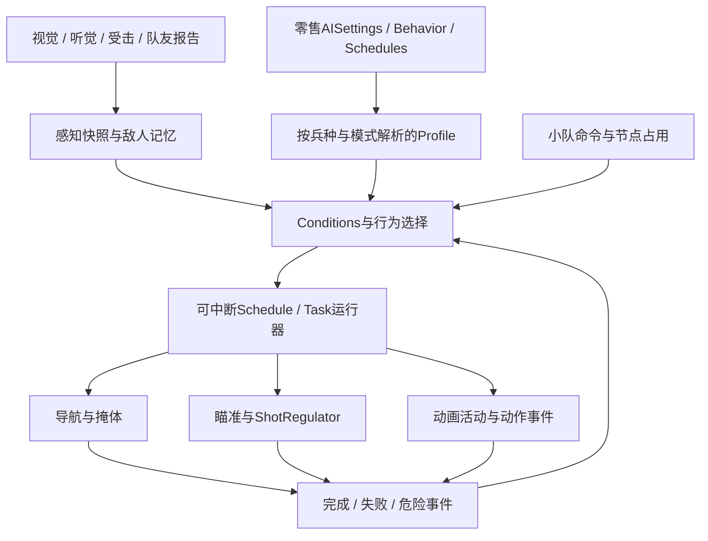

# 泰坦陨落 2 NPC 逻辑复刻研究

> 范围更新：用户随后明确以**泰坦NPC的技能配合、动作逻辑，以及NPC跳上房顶等跨越能力**为重点。最新实施顺序与结论见同目录 `TITAN_NPC_COMBAT_AND_TRAVERSAL_RESEARCH_2026-11-28.zh-CN.md`。本文保留通用NPC基础研究；下面“Grunt优先”是收窄范围之前的建议，已由新报告替代。

日期：2026-11-28。范围：当前 `D:\sbox\sbox-mounts\Titanfall2` 挂载的 NPC；源码基点 `main / b34a4454e2f671a9f601ffcb0638a99561e32a00`，同时包含当前未提交工作区，不能把该提交当作全部被审计内容。三个子智能体分别审计当前实现、提取零售行为数据、核对第一方公开资料；主代理复核并独立分析零售 server.dll。

**结论：最有价值的路线是恢复“零售角色配置 → 行为选择器 → 可中断任务 → 感知/射击/导航/动画执行”的契约。** 当前基础足够继续使用；首批应做一套可对照的 Grunt（SP/MP 分开），再用 Stalker 验证兵种差异。优先补行为时序与中断，而不是继续增加通用战术 if 分支。

本轮交付研究报告和静态证据，没有修改生产代码、部署挂载、运行原版动态 A/B 或声称通过运行测试。

## 1. 原版逻辑的三个证据层已经对上

### 可读的零售资源

本轮直接从零售 frontend、mp_common、sp_training VPK 定向提取 **368 个条目**：38 个 aibehavior、292 个 aisettings、36 个 vscripts、2 个 weapon。计数包含跨包重复，不是368个唯一文件。关键证据来自零售包，不是 Northstar 模组覆盖。

资源中已经有：

- `aisettings/npc_soldier.txt`：兵种、hull、血量、武器、SP/MP behavior selector、视野、notice、遗忘、威胁与反应配置。
- `aibehavior/behavior_soldier.txt` / `behavior_sp_soldier.txt`：Common/Idle/Alert/Combat 下按顺序排列的选择器。
- `aibehavior/common_schedules.txt`：任务序列、任务参数、中断条件、失败调度。
- `vscripts/ai/_ai_soldiers.gnut`、`_ai_lethality.gnut` 等：武器/熟练度选择、致命性设置、小队命令及角色行为。

例如，MP soldier Combat 数据包含近战、掩体射击、追敌、新敌人反应、低弹药规避、小队分配节点、不同射击分支、遮挡敌人处理。SP 另有换武器、交战距离相关选择器；MP 文件中的 ThrowGrenade 被注释、SP 启用。**这只描述该入口，不等于所有 MP NPC 路径都没有手雷。**

### 实际原生实现

用户提供的 MCP 当前打开的是 `engine.dll`。NPC 关键实现定位到了游戏根目录的 **`server.dll`**；主代理在 artifacts 副本上使用 IDA idalib 建库，保留原 engine IDB 和窗口状态。

本版 server SHA256：`a5ca3a25c8ae56952a26141b0f6cdcb6c19086c8c39013f7cb345d5d723661af`；imagebase：`0x180000000`。

| 已定位内容 | 地址 | 证据强度 |
| --- | --- | --- |
| aibehavior 文本加载/解析 | `0x1803AFC30` | 直接消费 scripts/aibehavior 路径、Selector、函数名与 health 条件 |
| Combatant 选择器注册 | `0x18034BF90` | 同项函数指针与名称绑定，能从资源函数名跟到实现 |
| MoveToSquadAssignedNode | `0x18034CED0` | 节点检索、hull 位置、资格与移动判定；分配算法仍待追踪 |
| ShootingCover | `0x18034CFF0` | 多阶段状态、时钟、计数器与候选验证，远超单个掩体坐标 |
| CombatNewEnemy / CombatOccludedEnemy | `0x18034C9B0` / `0x18034CD10` | 已找到真实入口；条件枚举/全部分支语义未恢复 |
| MaintainSchedule | `0x18031EB50` | 原版诊断文本锚点；推进任务、失败分支、启动/运行与执行预算 |
| 调度有效性辅助函数 | `0x18031E3F0` | 条件与中断mask交集、任务完成和失败判定；名称为研究归纳 |
| cone 收敛运算 | `0x1802EEC90` | setter→全局参数→消费者链已对上，见下文 |

这证明复刻可以沿资源与原生边界逐层推进。并不证明已完整恢复所有行为、枚举编号或内存结构；不可直接套用 Valve SDK 的枚举数字。

### 设计目标的第一方依据

Respawn 的 Carlos Pineda 在 GDC 2017《Solving Titan-Sized Problems》p51–53 说明：Titan AI 根据玩家已经发生的开火尝试防御/冲刺，遵守相同技能冷却；Boss 更积极使用能力，并会退入掩体回盾。这适用于 Titan 设计，不能外推成所有步兵细节。来源与页码见本地公开资料笔记；Valve Source SDK 只作为调度架构参照，Northstar 文档只作为接口索引。

## 2. 当前最影响还原度的差距

下表是当前源码审计及零售数据对比。潜在场景表现尚需实际运行复现。

| 优先级 | 当前实现 | 应优先补齐 |
| --- | --- | --- |
| P0 感知一致性 | 普通地面走 Senses/最后目击；FD、悬浮和固定单位的 FindTarget 按范围/评分选人，移动读实时目标位置 | 所有角色共用有来源的 contact snapshot；任务目标知识和敌人感知分开 |
| P0 行为中断 | Engage 不可中断，只有一个综合 Tick task；投雷/近战早返回可跳过危险检查，待机无同一路危险规避 | 独立危险感知；显式任务开始/运行/完成/失败/取消，按动作阶段决定能否中断 |
| P0 阵营一致性 | SetupRelationships 把 imc 与 Enemy 设友方，自定义 IsHostileToFaction 未归并它们；实际引擎 Enemy 常量为 `enemy` | 一个关系查询入口服务 Senses、目标选择、手雷安全和友军挡枪 |
| P1 角色与模式 | reaction、burst/pause、近战等不少值按名称/体型硬编码 | AISettings profile 有明确 SP/MP、继承、难度/脚本覆盖和字段来源 |
| P1 射击时序 | 固定 BurstShots/BurstPause、反应倒计时后瞄准当前点 | NPC专用 burst/rest、proficiency、cone/pattern 收敛与重新捕获时钟 |
| P1 掩体闭环 | 环形候选评分、遮挡和路径检查已有；缺少原版探头/退回等任务语义 | 掩体占用、进入/对齐/探出/开火/退回、失效与寻路失败回退 |
| P1 小队分工 | 有同阵营广播、队形偏移与分散评分，无独立 squad identity/分配生命周期 | 小队身份、目标报告、节点与掩体占用；攻击/投雷配额作为可验证设计，不冒充已恢复原版算法 |
| P2 动作同步 | 近战/投雷以固定倒计时为主，动画按时间缩放 | 动作事件驱动 contact/release/finish，中断后清理与计时fallback |
| P2 导航与语音 | 已有按尺寸配置的 NavMeshAgent、按需网格和基础语音 | 验证各hull可达/跨越连接/动态障碍；语音由真实行为事件触发 |

代码落点：`Npc.cs:143,307,357`，`Npc.Schedules.cs:20`，`Npc.Tactics.cs:183,233,324`，`ActorPrefabLoader.cs:68`。详细行号、现有测试和证据在 `current-code-audit.md`。

两个额外的数据泄漏点应一并收敛：不可见时的搜索评分仍读取目标当前朝向；无线电报点与自身目击时间混用，可能改变“最近亲眼看见才可投雷”的判定。两者都应由 contact 来源和时间戳表达。

## 3. 射击逻辑应该怎样恢复

**先区分武器本体的射速/射击模式与 NPC 决定连续开几枪、停多久的控制器。** 当前已消费的 NPC damage/cone 应保留。

零售 R-201（`mp_weapon_rspn101.txt:216–219`）基础 NPC 配置为 burst **2–4发**、rest **0.5–0.8秒**；同文件还存在 proficiency additional_rest，所以这个区间不能直接当作所有实际最终停火时长。应保留基础值、熟练度和脚本覆盖，随后验证组合规则。

原生 cone 的相关分支已确认随时间收敛：

```text
t = max(now - focusReferenceTime, 0)
if 0 <= t < focusTime and defocusedMultiplier > 1:
    cone = baseCone * (1 + (1 - t/focusTime) * (defocusedMultiplier - 1))
else:
    cone = baseCone
cone *= anotherNativeScale
```

这是 `server.dll 0x1802EEC90` 的已观察运算，不是全部命中公式。它有目标资格、敌人记忆、proficiency 与武器覆盖门槛；focusReferenceTime 是记忆字段，启动/重置语义仍需补全。不能简单改为“出生后6秒逐渐必中”。

`_ai_lethality.gnut` High 路径设置 cone focusTime=6、defocusedMultiplier=2.5，VeryHigh 为5/2.0；setter 验证参数范围，消费者实际使用。pattern 另有消费者 `0x1802F0E80`，重捕获更新路径为 `0x180366240`。下一步沿这些函数的调用者与字段写入恢复时间起点，比继续调一个固定 Accuracy 更有依据。

## 4. 建议在当前架构上这样落地

保留 `Titanfall2Npc : BaseCombatNpc`、宿主权威、六个控制器、现有武器和动画执行器。新结构是渐进替换方案，不声称是原版 C++ 类图：



建议数据契约：

- **ContactSnapshot**：最后已知位置、瞄点、速度、朝向；LastSeenAt/LastHeardAt/LastReportedAt 分开，保留来源；不可见时禁止其它控制器绕过快照读实时敌人状态。
- **ConditionSnapshot**：能看见、枪线受阻、友军挡枪、弹药、危险、路径完成/失败、动作结束、目标改变。
- **Schedule/Task**：Start/Run/Complete/Fail/Cancel；中断掩码与失败schedule；执行预算和路径超时；清理覆盖移动、投掷、动画、占位。
- **ActionResources**：腿部、瞄准、主武器、投掷、全身动作的使用约束；允许合理移动+开火，避免两个控制器互相覆盖。
- **Profile provenance**：每字段记录原包/路径/模式/覆盖来源，区分 retail-confirmed、fitted、fallback。

第一版只支持当前需要的零售语法，并明确报告尚未实现的 selector/task。未知动作不得被静默视为成功；可以显式降级并写诊断。不要为了“通用”先构建完整 Squirrel VM、GOAP 或另一套大框架。

## 5. 实施顺序与交付门槛

| 阶段 | 具体交付 | 通过标准 |
| --- | --- | --- |
| A 基线 | 冻结一张对照场景、Grunt/R-201、SP/MP模式、种子与来源；建立每次决策日志 | 能回答为何发现/开火/换目标/中断，不只看到NPC在移动 |
| B 输入与中断 | 阵营统一、contact统一、危险仲裁、任务生命周期 | 隔墙未知移动不改变追踪点；待机/射击/换弹/投雷/近战按定义的阶段响应危险；取消不残留占用 |
| C 射击 | NPC burst/rest、proficiency字段、cone时间曲线；原生尚不清楚的字段显式近似 | 正确消耗真正发出的枪数；重捕获时钟可追踪；友军过枪线停火；比较首发与伤害分布 |
| D 掩体与小队 | 先实现range attack、hide/reload、move-to-assigned-node、shooting-cover子集 | 无可达掩体时回退换弹；重复争抢不占同槽；动画完成推进任务；掩体失效释放 |
| E 第二兵种 | Stalker独立selector，保留相同底层执行器 | 不继承不适用的soldier掩体流程；不同策略来自profile/selector而非体型猜测 |
| F 专属角色 | Reaper长跳/躲弹/突进；一个Titan的真实反应/防御；再扩FD mortar | 分别验证移动可达与动作生命周期；Titan防御不早于可观测攻击、遵守冷却；mortar退出释放阵地 |

其中 C 的参数读取可独立推进，但还原度验收必须在 B 的感知与中断一致后进行，否则无法分辨命中变化来自射击参数还是透视式目标输入。

## 6. 还原度验收不能只看“能否击杀”

原版与挂载使用同一场景条件；可控制时固定种子，不可控制时重复采样并比较分布。不要许诺在尚未确认工具能力前能从零售进程读取全部内部状态；原版先用录像/可用日志获取外部事件，必要时再补只读观测。

| 场景 | 需要比较的量 |
| --- | --- |
| 远/近/周边进入视野、不同高度 | notice完成、首发/首次命中时间，角色转向与FOV边界 |
| 遮挡后移动，再出现；仅队友报告 | 最后已知位置、重捕获延迟、搜索方向、信息来源 |
| 友军横穿枪线；单兵持续射击 | burst长度、休止分布、实际枪数、重新开火时点 |
| 有/无可达掩体的空弹夹 | 掩体选择、路径失败回退、reload完成、首次允许开火 |
| 待机/换弹/投雷/近战时出现危险 | 反应时延、可取消窗口、动作恢复与资源清理 |
| 四人小队争抢两个掩体、穿窄门 | 占位冲突、角色分配、同时开火数、路径卡住恢复 |
| 跨越/隐身铁驭、Reaper突进 | 是否产生对应条件、动作起止、移动连接与碰撞 |
| Titan对慢弹、低盾Boss、mortar受伤 | 防御响应与冷却、撤退/回盾再交战、阵地释放 |

建议日志至少含 actor/profile/mode、contact来源与年龄、condition、selector、schedule/task、interrupt/fail reason、nav status、cover/squad slot、burst余量、focus计时、动画phase及实际伤害事件。先从挂载侧完整记录；原版观测不足的项明确标注。

现有规则测试、隔墙伤害测试、手雷碰撞/取消测试可扩展，不能替代这些行为验收。本次仅研究，因此未重新跑编译或测试。

## 7. 证据、限制与下一轮逆向入口

研究根目录：`D:\sbox\sbox-mounts\artifacts\npc-fidelity-research-20261128`。

- `current-code-audit.md`：当前实现的行号、具体问题、引擎阵营常量核对、测试扩展位置。
- `scripts/retail-script-findings.zh-CN.md`：逐项零售字段、脚本与任务证据。
- `scripts/retail/manifest.json`、`scripts/archive-hashes.json`：提取来源与哈希。
- `native/native-findings.zh-CN.md`、`native/server-survey.json`、`native/native-*.c`：原生证据链与反编译；后续native结果补充了脚本子报告当时未确认的focus参数意义。
- `public-reference-findings.zh-CN.md`：Respawn GDC页码、Valve架构参照、Northstar接口资料及其适用界限。
- `baseline.json`：本次源文件/原版模块身份记录。

下一轮优先：恢复 condition/schedule 符号编号 → 补 memory focus时钟 → 跟 ShotRegulator 的 rest/proficiency运算 → 追 squad节点分配和 cover占用。此次未恢复完整感知累积、全套路径节点格式、所有动画事件、Reaper/Titan专属判断、所有难度脚本覆盖，也未确认当前在线MP服务端所用资源版本。

第一方公开来源索引：

```text
Respawn / GDC 2017，Carlos Pineda，PDF p49、51–53：
https://media.gdcvault.com/gdc2017/Presentations/Pineda_Carlos_Solving_Titan_Sized.pdf
https://www.gdcvault.com/play/1024056/Solving-Titan-Sized-Problems-Evolving
Valve 官方 Source SDK（架构参照，不是TF2代码）：
https://github.com/ValveSoftware/source-sdk-2013/blob/master/src/game/server/ai_basenpc_schedule.cpp
Northstar 项目自身的社区接口/导航记录：
https://r2northstar.readthedocs.io/en/latest/reference/respawn/native_server/npc.html
https://github.com/R2Northstar/NorthstarNavs
```
