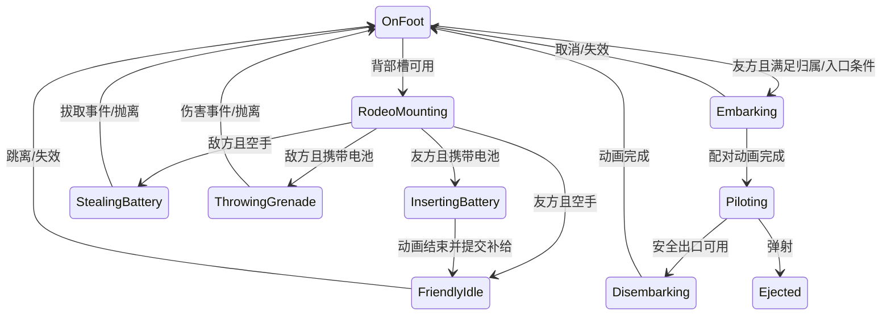

# 铁御登离舱、敌方训牛术与友方搭乘研究

研究日期：2026-11-28。目标：将 Titanfall 2 的互动流程迁移到 s&box 挂载模块，复用原始动画、附件与事件，并分离宿主权威玩法和本地动画表现。

本文依据本机 `D:\northstar` 中的共享脚本、Northstar 内置服务端脚本及当前 s&box 挂载代码。`scripts/` 是共享行为首要证据；不存在对应服务端文件的部分使用 `mods/Northstar.CustomServers/` 补齐；`mods/Northstar.Custom/` 的扩展单列。未把第三方 FD 模组同名文件当作默认游戏规则。

## 1. 结论与状态边界

三种交互共享动画技术，但不能合并成一个驾驶座状态：

| 交互 | 铁御获得的能力 | 结束条件 |
|---|---|---|
| 自有/可认领友方泰坦登舱 | 控制泰坦，铁御步行武器停用，驾驶舱视角 | 普通离舱、弹射、死亡、销毁 |
| 敌方训牛术 | 爬上泰坦；空手拔电池，已有电池投雷 | 动画事件提交伤害后抛离，或提前取消/死亡 |
| 友方背部搭乘 | 有电池先补给，随后保留铁御武器自由瞄准 | 主动跳离、死亡、销毁 |

默认电池式训牛的投雷分支取决于**铁御是否携带电池**，不是泰坦是否曾被拔过电池。友方补电池结束仍继续搭乘；它既不成为驾驶员，也不应覆盖驾驶员的控制输入。背部只有一个 rider 槽，与驾驶舱占用独立。

## 2. 可追溯源文件

下表简称仅用于本文，均为本地绝对目录：

- `S`：`D:\northstar\scripts\vscripts`
- `N`：`D:\northstar\mods\Northstar.CustomServers\mod\scripts\vscripts`
- `C`：`D:\northstar\mods\Northstar.Custom\mod\scripts\vscripts`
- `P`：`D:\northstar\scripts\players\mp`

| 主题 | 证据入口 |
|---|---|
| 登离舱动画分派与选择 | `S\titan\sh_titan_embark.gnut:91,124,211,884,1478,1555,1813` |
| 泰坦/铁御实体转换 | `N\mp\_titan_transfer.nut:378,495` |
| 弹射 | `S\titan\sh_titan.gnut:318,477,593,660` |
| 驾驶舱弹射1P | `S\client\cl_titan_cockpit.nut:1029` |
| 配对1P/3P动画播放器 | `N\_anim.gnut:1028` |
| Rodeo门禁、方向、距离 | `S\rodeo\sh_rodeo.gnut:73,105,152,193,240,289` |
| Rodeo目标、包与单槽 | `S\rodeo\sh_rodeo_titan.gnut:69,106,188`；`S\sh_entitystructs.gnut:2` |
| Rodeo动画与音效别名 | `S\rodeo\sh_rodeo_titan_anim.nut:14,150,198` |
| 进场、主动跳离 | `N\rodeo\_rodeo.gnut:83,259,352,374` |
| 敌友分派、电池与伤害 | `N\rodeo\_rodeo_titan.gnut:538,802,883,985,1072,1222,1701` |
| 友方搭乘伤害保护 | `N\rodeo\_rodeo_titan.gnut:235`；`N\pilot\class_wallrun.gnut:73` |
| Northstar classic rodeo扩展 | `C\rodeo\_rodeo_titan.gnut:355,840` |

这些行号记录本次读取的工作树；后续修改应重新确认，不能当作游戏内验收证据。

## 3. 登舱、离舱与弹射

### 3.1 登舱

`sh_titan_embark.gnut:91–94` 为 atlas、buddy、ogre、stryder 调用 `AddEmbarkAnims(..., thirdPersonOnly=true)`；`:124–164` 会清空该分支1P别名。因此普通多人登舱应表现为铁御/泰坦配对3P演出及相机过渡，不应擅自把 `ptpov_mount_*` 的存在等同于当前默认路径。

方向选择包含 `above_close`、`above_grab`、front/left/right/behind。源码入口表 `:211–474` 还保存距离、dot阈值和优先级：above_close 为350/.88/优先0，above_grab 为275/.3/优先0，地面四向260/.4/优先1，front fallback 为260/−1/优先2。`:1960–1965` 中站立方向计算有 yaw −30 修正。首版只做地面四向时必须标明覆盖范围。

铁御序列以 `pt_mount_{subclass}_stand_{direction}` 分派，泰坦为 `at_mount_stand_{direction}`。`:884–915` 的序列使用 `hijack`、animated REF与0.5秒blend；`:919–923` 设置铁御3P VDU相机。`:934–937` 处理 `phase_shift` 与 `cockpit_light`，`:1171` 包含 `play_startup_sound`。`:976–997` 在动画后执行 `PilotBecomesTitan`，再删除原NPC实体。

s&box 可以保持一个稳定泰坦组件而不复制“销毁NPC、创建玩家泰坦”的实体策略，但必须保持归属、生命、护盾、装备、核心、AI控制和外部骑乘关联连续。

### 3.2 离舱

`:1478` 先 `TitanBecomesPilot` 再播放下机动画。`:1555–1615` 使用：

- 铁御3P：`pt_dismount_{subclass}_{stand|crouch}`。
- 铁御1P：`ptpov_dismount_{subclass}_{stand|crouch}`。
- 泰坦：对应 `at_dismount_*`；快速下机追加 `_fast`。

普通离舱需要有效出口与姿态检查，不能点击后立即解除座椅再播放装饰动画。原版还包含前向250、向上200的下机速度，以及1.65秒重新登舱限制（`:1813–1865`）。清理逻辑见`:753–766,1747–1784`。

### 3.3 弹射

`S\titan\sh_titan.gnut:318–319` 定义0.8秒弹射过程与0.4秒最大延迟补偿；`:477–495` 选站立/蹲姿 `at_MP_eject` 和核弹版本；`:593–604` 完成实体转换。`:660` 基础速度1500–1700，核弹加400，并按重力比例处理；`:669–685` 先将背部骑乘者甩开。驾驶舱1P动画在 `cl_titan_cockpit.nut:1029–1065`，为 `atpov_cockpit_eject[_nuclear]`。

普通离舱与自毁弹射要保持不同状态、伤害后果和输入。

## 4. Rodeo触发、占用与定位

原生引擎先查询 `CodeCallback_IsValidRodeoTarget`，再用 `CodeCallback_OnRodeoAttach` 返回的 attachment、1P/3P动画与slot，之后服务端 `CodeCallback_StartRodeo` 启动玩法。脚本没有给出原生碰撞候选搜索全部实现，因此“靠近自动挂上”的候选算法仍需单独验证。

共享门禁拒绝：正在下机、非泰坦、无有效soul、已有rider、hotdrop、玩家已骑乘、泰坦弹射中、双方相位不一致。`HoldToRodeo`支持自动、全部需要Use、仅友方需要Use三档（`sh_rodeo.gnut:101`）。

距离默认180；若目标是玩家驾驶泰坦，按其看向铁御的dot从100插值到180。敌方目标的lastRodeoHit在2秒内时阈值乘0.6。距离计算点是 `hijack.Position + (0,0,40)`，实际动画锚点仍是原始 `hijack`，不能重复加40。

高处落入条件：高度差≥40，竖直速度≤−120，视线dot≥.8且速度方向dot≥.8。一般跳上根据前后dot、高度和左右dot选择 front_lower、rear_lower、rear_middle、left、right；从上方则选front_upper/rear_upper或左右。

`sh_rodeo_titan.gnut:188` 固定 `rodeoSlot=0`，`sh_rodeo.gnut:359`也只读slot0。`eRodeoPositions`枚举、保留数组和旧注释不证明可同时搭乘三人。

## 5. Rodeo动画资产与事件

### 5.1 进场与持续附着

进场是 `pt_rodeo_move_{atlas|ogre|stryder|buddy}_{direction}_entrance` 与 `ptpov_...` 成对分派；方向后缀包括back、right、front、front_lower、back_mid、back_lower、left。精确映射在 `sh_rodeo_titan_anim.nut:14–83`。

普通跳上blend为0.6秒；从上方落入则 `clamp(distance/speed*.95,.4,1)`。`N\_anim.gnut:1068`把相机接到1P proxy；`:1181,1198`给铁御和proxy同一父附件；`:1221,1263`并行播放1P/3P；`:1248,1293`支持animated REF替代root motion；`:1296–1301`等待两者完成。只把两套模型摆到同一世界坐标会丢失这个参考系关系。

### 5.2 电池式训牛精确序列

| 机架/动作 | 铁御3P | 铁御1P |
|---|---|---|
| atlas 拔电池 | `pt_rodeo_ride_R_hijack_battery` | `ptpov_rodeo_ride_R_hijack_battery` |
| atlas 补电池 | `pt_rodeo_ride_R_return_battery` | `ptpov_rodeo_ride_R_return_battery` |
| atlas idle | `pt_rodeo_ride_R_idle` | `ptpov_rodeo_ride_R_idle` |
| atlas 投雷 | `pt_rodeo_medium_grenade_1st` | `ptpov_rodeo_medium_grenade_1st` |
| ogre 拔电池 | `pt_rodeo_ogre_hijack_battery` | `ptpov_rodeo_ogre_R_hijack_battery` |
| ogre 补电池 | `pt_rodeo_ogre_return_battery` | `ptpov_rodeo_ogre_R_return_battery` |
| ogre idle | `pt_rodeo_ogre_panel_aim_idle_move` | `ptpov_ogre_rodeo_panel_aim_idle` |
| ogre 投雷 | `pt_rodeo_heavy_grenade_1st` | `ptpov_rodeo_heavy_grenade_1st` |
| stryder 拔电池 | `pt_rodeo_stryder_ride_R_hijack_battery` | `ptpov_rodeo_stryder_R_hijack_battery` |
| stryder 补电池 | `pt_rodeo_stryder_ride_R_return_battery` | `ptpov_rodeo_stryder_R_return_battery` |
| stryder idle | `pt_rodeo_stryder_panel_aim_idle_move` | `ptpov_stryder_rodeo_panel_aim_idle` |
| stryder 投雷 | `pt_rodeo_light_grenade_1st` | `ptpov_rodeo_light_grenade_1st` |

来源：`S\rodeo\sh_rodeo_titan_anim.nut:150–189`。子类来自 `sh_titan_soul.gnut:63`的player settings subclass；Monarch `P\titan_atlas_vanguard.set:1`继承atlas。BT `P\titan_buddy.set:37`显式 `rodeo_allow 0`，且上述电池式别名没有buddy的完整映射；不能默认宣称BT有原版等价的电池式训牛。

### 5.3 提交事件

| 名称 | 原版作用 |
|---|---|
| `rodeo_battery_show` | 显示手持临时电池；舱盖改down idle |
| `rodeo_battery_rip` | 提交伤害、创建并授予电池、抛离 |
| `rodeo_battery_grenade_show` | 显示临时手雷 |
| `rodeo_battery_grenade_damage` | 复用拔电池提交回调，伤害并抛离 |
| `rodeo_battery_stealth_movement_warning` | 低调技能的延迟预警 |
| `RodeoPointOfNoReturn` | 停止主动跳离监听；影响舱盖中断恢复 |

来源：`N\rodeo\_rodeo_titan.gnut:907,973,987`。补电池与上述不同：`:1193–1206`等待 `FirstPersonSequence` 完成后才提交补给。客户端动画事件只能表现道具/音效，宿主必须使用会话序号与一次性提交门，防止重复伤害或重复电池奖励。

### 5.4 模型不能混用

- 可拾取电池：`models/titans/medium/titan_medium_battery_static.mdl`，`S\sh_common_models.gnut:19`。
- 动画临时电池：`models/props/titan_battery_static/titan_battery_static.mdl`，`N\rodeo\_rodeo_titan.gnut:58`；铁御主体和1P proxy各挂一个到 `R_HAND`，见`:892–905`。
- 临时手雷挂 `PROPGUN`，见`:991–1002`。
- 机体电池舱是独立模型：`models/titans/{medium|heavy|light}/titan_{medium|heavy|light}_rodeo_battery.mdl`，对应 `P\titan_atlas.set:20`、`titan_ogre.set:12`、`titan_stryder.set:22`。
- 舱盖动画为 `hatch_rodeo_{medium|heavy|light}_{up|up_idle|down|down_idle}`。
- 默认铁御body/arms是 `models/humans/pilots/pilot_medium_reaper_m.mdl` / `models/weapons/arms/pov_pilot_medium_reaper_m.mdl`（`P\pilot_base.set:11–13`）；这是默认模型配置，不能代替实际资源含有所需sequence的检查。

## 6. 玩法数值、友方视角和伤害

`N\rodeo\_rodeo_titan.gnut:1222`：拔电池基础伤害为一个Titan segment；铁御已有电池时投雷为半个segment；Doomed改为当前生命+1，Hardcore另有逻辑。电池计数扣减后下限0。此伤害仍经过正常护盾吸收：`S\sh_death_package.gnut:82`的`rodeoBatteryRemoval`只有`DF_RODEO | DF_EXPLOSION | DF_STOPS_TITAN_REGEN`，没有`DF_BYPASS_SHIELD`；参见`N\titan\_titan_health.gnut:191–223`、`N\_utility.gnut:3738,3841`。不能把基础伤害直接等同于每次必然扣除的机体生命。

`:1747–1781`：普通MP电池默认恢复0.5格生命、充满盾、增加20%核心；强化电池默认2格且可解除Doomed。普通电池也可补充Doomed生命池而不解除Doomed：`N\titan\_titan_health.gnut:630–662`进入该状态时将实体MaxHealth改为maxDoomedHealth，随后补电池的`min(maxHealth, health+1250)`自然限制在Doomed生命上限。Playlist可覆盖部分参数。代码虽然读取 `battery_shield_frac`，实际分支直接设置满盾，不能只按变量名称推断效果。SP回血规则不同，见`:1709–1745`。

友方idle通过 `Rodeo_OnFinishClimbOnAnimation`与`FriendlyRodeoDeployWeapon`恢复武器，仍保留单手武器模式（`:725,794,818`）。`:2025`隐藏第一人称proxy，取消view cone并使用world-space eye angles，使铁御自由瞄准。客户端camera smoothing辅助函数存在，但 `S\rodeo\cl_rodeo.gnut:17`常量为0，不能记为已开启特性。

友方泰坦有盾时为rider设置 `PassDamageToParent=true`，盾耗尽取消（`_rodeo_titan.gnut:235,659`与`N\titan\_titan_health.gnut:220,765`）。这不是无敌。另有0.5秒伤害限额、NPC攻击例外和烟雾/近战例外，见 `N\pilot\class_wallrun.gnut:73–155`。

## 7. 跳离、中断与清理

主动跳离0.6秒防抖，到不可返回点后结束监听（`N\rodeo\_rodeo.gnut:352`）。普通跳离为输入方向×350，竖直390；boostEnabled则竖直200，没有输入则水平0（`:374`）。拔电池/投雷抛离相对泰坦向后，水平系数450、竖直80；暂移z100后做安全点修正（`_rodeo_titan.gnut:400,2172`）。抛离先消费二段跳与空控，0.45秒后恢复二段跳，后续最多0.75秒特殊空控窗口，着地/贴墙提前结束（`:2229`）。

统一出口必须恢复或释放：parent、相机、动画、站立锁、单手武器、伤害转移、slot、目标引用、声音、临时道具、事件订阅、武器禁用状态、隐身剩余时间、物理运动。泰坦死亡/销毁、玩家死亡/断线、地图卸载都要进入同一清理路径。原版用稳定soul重新取得驾驶/AutoTitan转换后的实体（`_rodeo_titan.gnut:538–640`）；s&box可使用稳定组件/会话身份达到同等目的。

提供电池提示5秒、请求电池10秒、请求提示30秒是HUD/交流冷却（`sh_rodeo_titan.gnut:18–22`），不能误用为所有rodeos的重入冷却。

## 8. Northstar扩展与未确认内容

`C\rodeo\_rodeo_titan.gnut:840–883` 的 `classic_rodeo=1`允许拔电池后留在背上、创建弱点hitbox、持续射击并手动处理跳离。这是Northstar可选扩展，不是默认TF2敌方电池玩法。FD核弹电池还有独立条件与窗口，首版未覆盖时应单列。

脚本调研不能证明：具体MDL事件帧时长、原生候选搜索、骨骼/坐标转换后root motion精度、1P相机碰撞质量、远端客户端预测及网络延迟表现。事件时间应从已解析的retail sequence metadata取得；缺失时需要显式diagnostic与fallback说明，不得默默把猜测秒数标为原版时序。

用户提供的IDA实例指向 `engine.dll`；它可供核对基础动画/实体机制。是否含有所需游戏层逻辑必须先按模块证据判断，不能把引擎符号存在当作已定位Titan rodeo的原生实现。本节不声称完成native反编译验收。

## 9. 本轮native验证fixture

新增 `Validation/TitanInteractions.cs`，入口 `CheckTitanInteractions`；suite注册由主实现统一处理。fixture保留实际ally/enemy Monarch prefab和模型，停用自主战斗，在真实 `MountHost`、`Scene.GameTick`、原生 `PlayerController`/MoveMode中检查：

1. 敌方驾驶舱拒绝、不修改阵营；他人owner拒绝。
2. 实际配对登舱开始、外部传送取消、恢复控制和临时presentation清理。
3. 按真实clip duration等待完整登舱/离舱，检查SitMoveMode、碰撞体、归属与库存。
4. Rodeo单槽、重复请求不替换session、过期session不能重配提交时钟。
5. 空手敌方拔电池一次，携电池敌方投雷一次，完成后继续tick不重复结算；敌方fixture将MaxShield设0以隔离基础伤害，不冒充护盾穿透测试。
6. 友方补电池只提交一份生命/盾/核心奖励，然后idle可射击且不占驾驶舱。
7. 主动跳离与泰坦销毁恢复铁御控制。
8. 额外带1000护盾的敌方实例验证一次2500基础伤害先消耗1000盾、再扣1500机体生命；在提交帧读取，避免护盾恢复污染结果。

fixture不加速真实动画；记录 `UsesAuthoredTiming` 与diagnostic，区分真实metadata时序和fallback。核心奖励断言扣除`Time.Delta / BuildSeconds`的被动增长，分别在插入提交帧与90帧后核对“被动增长 + 一份20%奖励”，不能把整个动画之后的核心读数硬写为0.2。

图形模式在登机中段、下机中段、拔电池过程、友方搭乘idle采样。每个阶段输出固定侧方相机的`*-side.png`，可用时另存`*-authored.png`。场景提供固定环境光和方向光；每次捕获记录相机、pilot rig、hijack与animated REF位置及距离，检查finite。截图来自正常帧推进，渲染重复只用于GPU完成，不修改动作时钟或生产代码渲染开关。1P路径会隐藏3P铁御，侧方图可能只显示泰坦，此时需要同时查看authored图和记录中的`ThirdPersonVisible`，不能据此断言铁御动画缺失。

该文件写入本身不代表运行通过，必须以本轮独立native报告的 `success` 与各项记录为准。玩法/动画首版的实际覆盖、构建结果、native报告及未完成清单由最终实现验收补录。

## 10. 当前实现补记

当前源码已增加 `Code/Gameplay/Titans/Interaction/TitanInteractionPresentation.cs`，播放独立的原版铁御/1P骨架，按animated REF对齐泰坦hijack，并在结束时恢复原renderer/动画图。`Rodeo/TitanRodeo.Presentation.cs`使用真实sequence长度和可用的提交事件；缺失提交事件时显式标记`commit fallback=clip completion`。需要动作动画而资源不可用时取消交互，不在没有动画的情况下静默提交伤害。

手持电池和手雷已新增到presentation：电池`R_HAND`、手雷`PROPGUN`，归还电池从序列开始显示，拔电池/投雷按`rodeo_battery_show`或`rodeo_battery_grenade_show`事件显示。对应真实手雷模型为`models/weapons/grenades/m20_f_grenade.mdl`（`S\sh_death_package.gnut:52`）。手持电池的原生截图确认和其他验收范围见第11节，未单独截取投雷手持道具画面。

本轮尚未实现独立泰坦电池舱盖模型及其up/down动画、地上电池拾取/投掷全流程、完整原版空控曲线、所有高空入口与FD核弹/Classic扩展；远端客户端驾驶/预测也不在首版验收范围。当前局部交互不能表述为全部原版机制已完整复刻。

原版资源中发现部分事件Cycle非finite，`Code/Resource/Model.Animations.cs`的JSON投影以`Cycle=null`及`ValidCycle=false`保留诊断；内部原始事件仍保留，消费者只接受有限且处于[0,1]的时间点。该处理避免资源metadata序列化失败，不表示无效事件已被修复为有效动画时序。

## 11. 首版验收结果（2026-11-28）

实现已写入当前工作区，未提交、未向 Steam 安装目录部署；原有未提交改动保留。入口为 `Chassis/TitanSeat.Interaction.cs`、`Interaction/TitanInteractionPresentation.cs`、`Rodeo/`，由 `PilotInputInterceptor`处理交互输入，`PilotCombatHud`显示携带电池与搭乘状态。

操作：先装备跃升背包。对未认领或自己拥有的友方泰坦按使用键登舱，舱内使用键播放离舱；蹲伏+使用选择友方背部搭乘；对敌方、已占座或他人拥有的泰坦使用，进入敌/友Rodeo。跳跃键离开背部，保留0.6秒防抖及不可返回点。电池由拔取获得，投雷不消耗携带电池，友方补给成功后消费。

已通过：

- 官方 Steam 引擎 `MenuBuild.exe`沙箱编译及验证工程编译（0警告、0错误）。构建包：`D:\sbox\sbox-mounts\artifacts\titan-interactions-20261128\package\package.local.titanfall2.dll`。
- 99项 Titan、ActorAnimation、PilotParkour单测，无跳过，包含真实零售VPK的片段、事件、道具及挂点测试。报告：`Tests/TestResults/titan-interactions-20261128.trx`。最终补给/清理调整后10项 Boarding/Rodeo/Core规则再次通过：`titan-interactions-final-rules.trx`。
- 最终构建原生 `--titan-interactions`报告 `success=true`：`D:\sbox\sbox-mounts\artifacts\native-9bc7c2edb2ba42fa9d165e5d1cac2830\runtime-results.json`，MVID `0df884d6-3577-4074-a07f-dda34cca34ea`。9项行为检查：敌友/归属门禁、取消、完整登离舱、外部解父不回拉、拔电池/投雷各一次、友方补给后idle、销毁脱离、护盾吸收。另记录4项姿态和8张1280×960截图。
- Monarch实际后方登机3.4秒、站立下机1秒。拔电池和投雷均2.666667秒，提交来自真实事件，`UsesAuthoredTiming=true`；无盾伤害2500/1250；独立1000盾实例确认2500伤害分为1000盾与1500生命。补给回复1250、充满盾、核心增加20%，测试同时验证关闭武器战斗不阻止补给。
- 已查看同目录的 `embark-midpoint-side.png`、`disembark-midpoint-authored.png`、`rodeo-battery-theft-authored.png`、`friendly-rodeo-idle-side.png`。原版动作、1P手臂和手持电池可见。四次采样的ref/hijack最大误差约0.42单位；不是全动画/移动机体逐帧验收。测试地面仅碰撞体，截图背景不是完整地图。
- 原有 `--titan-cockpit`回归也已通过：`D:\sbox\sbox-mounts\artifacts\native-0d87949b7963432787bd139c0aed2e2f\runtime-results.json`，最终程序集MVID `0df884d6-3577-4074-a07f-dda34cca34ea`。覆盖实际使用键入口、库存恢复、四技能槽/核心/Q保留、HUD三种宽高比、TitanClip与离缘下落、完整玩家出口碰撞、离舱世界朝向保持、禁用与销毁恢复、Doomed后再次致命伤释放铁御。旧fixture已按现有火箭齐射门禁、允许离缘下落与Doomed生命池行为更新，未放宽这些production规则。验证时发现的离舱朝向问题已修复，过渡保存座舱世界朝向而非误用相对角度。

首版边界：

- 只接受本地玩家/监听主机；远端RPC、预测、远端配对动画重建和专服交互未实现，不能宣称多人联机完成。
- 登离舱锁住真实铁御运动体，用临时原版身体播放配对动画，结束时切换座位/重新扫掠的安全出口。未沿逐帧身体轨迹推进物理体；Rodeo爬升物理路径采用扫掠插值、视觉采用原片段。动画姿态有一帧评估边界。
- 已接地面四方向站立登机与站立下机；跪姿、空中抓取、快速专属变体未接选择器。弹射沿用现有弹出/自毁机制，未补完整准备动画及核弹变体。
- 手持电池/手雷已接显示事件；独立舱盖、随身背部电池、死亡掉落和地面拾取未实现。也未接自动跳入探测、友方护盾代挡rider伤害及完整NPC/低调/隐身/空控特例。BT遵循原版禁用电池式Rodeo。
- 归属复用友方阵营与`Leader`，泰坦保持稳定实体。实际验收用Monarch；其他机架动画通过资源解码，不等于所有机体全流程原生验收。未用真人输入、完整Sandbox玩家包、双玩家同时驾驶/搭乘或完整地图验收。
- 日志仍有普通NPC分层动画的64状态上限告警并使用既有序列回退；独立交互Graph不受其影响，但该问题未在本轮修复。测试环境另有缺少输入绑定、空样式、未加载屋顶导航的诊断；报告成功不表示模块无告警。
- `Tests/`、`Validation/`、`Build/`、`artifacts/`遵循现有Git忽略策略，验证文件保留本机，不会自动随普通Git提交传送。

IDA仅完成只读探针：实际输入 `D:\Game\steams\steamapps\common\Titanfall2\bin\x64_retail\engine.dll`，imagebase `0x180000000`。分析就绪，字符串搜索 `rodeo|embark|disembark|SyncedMelee|FirstPersonSequence|SetParent` 为0项，因此没有声称定位玩法原生函数，未修改IDB/游戏二进制。
