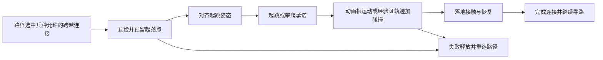

# 泰坦 NPC 技能配合、动作与屋顶跨越研究

后续实施记录见 [2026-11-28 改造说明](TITAN_NPC_AI_IMPLEMENTATION_2026-11-28.zh-CN.md)。本文保留研究时点的现状与证据，下面“尚未实现”等措辞不代表后续实现状态。

日期：2026-11-28。范围按用户补充要求聚焦：**泰坦自主战斗的技能配合与动作逻辑，同时补上 NPC 跳跃上房顶等跨越能力**。本文替代通用 NPC 报告中“先做Grunt”的实施排序。当前为研究交付，没有修改生产代码、部署或进行游戏运行验收。

结论：现有工程已有不少技能执行器，但还缺少把技能、武器、移动、动画组织成一个合法战斗过程的运行层；屋顶跨越又缺少角色能力、导航连接与动作执行之间的接线。应先修资源/动作不变量，再做 **Ion + Ronin** 的完整动作样板；跨越并行从 **Spectre/Reaper** 的固定屋顶场景验证，随后连接 Northstar 的专属空中动作。

## 1. 本轮实际获得的证据

- 当前仓库审计：普通 NPC、Kit、Core、FD、导航及动画；保留既有未提交修改。
- 零售 VPK：公共 NPC 定向提取368个条目，泰坦扩充663个条目，**包含跨包重复及两轮重叠**，不能相加成唯一文件总数；各有独立manifest和SHA256。
- 原生：用户给的 MCP 是 engine.dll；真正相关实现位于游戏根目录 server.dll。复制到本地研究目录后使用独立 IDA idalib 分析，未切换或修改用户正在打开的 engine IDB。
- 第一方设计资料：Respawn Carlos Pineda 的 GDC 2017演讲，Titan反应、技能冷却与Boss行为；不以Source SDK或Northstar社区实现冒充零售算法。

server.dll SHA256 `a5ca3a25c8ae56952a26141b0f6cdcb6c19086c8c39013f7cb345d5d723661af`，地址基址 `0x180000000`。源码基点 `b34a4454e2f671a9f601ffcb0638a99561e32a00` 加本次工作区内容。所有地址只针对该模块，反编译自动名不是原始调试符号。

## 2. 泰坦“复杂配合”的实际构成

### 战术态势改变候选动作

`behavior_titan.txt` 分 Common、Combat、CombatAggressive、CombatEvasive；Ronin、Legion、Northstar另有专属行为文件。配置还包括双方health+shield相关量、近期生命变化率差、交战距离、闪避周期和次数。**不能用一个“低血后退”分支代表这些模式**，也不能仅从列表推断所有运行中抢占规则；真正中断还要经过schedule条件与动作阶段。

### 技能有资格条件，不是冷却结束就按键

原生 `0x1806CE3F0` 读取 `npc_use_check_type`，两个消费者 `0x180311AB0 / 0x180311510` 按类型检查：tracker命中、地面路径、移动状态、回避态势、共享能量、宽视线、距离变化等。

其中资格检查有0/1/2三类结果：不通过、在这条调用路径立即通过、继续其它检查。移植时不应误压成一个普通bool。核心选择入口同样复用武器资格检查。

已确认的入口：

| 原生入口 | 地址 | 用途 |
| --- | --- | --- |
| TitanCore selector | `0x1806214A0` | 核心充能/目标/武器/动作资格检查，再交接核心武器与调度 |
| TitanFlightCore selector | `0x180621610` | 独立飞行核心资格与后续调度选择 |
| GotoDefensivePlacement | `0x180621380` | 具有期限和到达半径的防守位置命令 |
| MissileDodge | `0x180323BD0` | 来弹handle与相对位置/速度判断，再选择闪避调度 |
| StrafeDodge | `0x1803248D0` | 条件/累计量/profile门控，再进入侧闪调度 |
| 来弹防御概率门控 | `0x180622770` | 按生命百分比与配置调整概率；还受调用者的方向、动作和能力资格约束 |

例如防御概率参数原生默认注册为10与50，但它们不是“全局10%挡弹/半血无敌”：消费者之外还有来弹资格、方向、资源、动作门控，且实际配置可覆盖。完整链见原生研究笔记。

### 技能可能改造主枪，也可能切换整套AI

| 机体 | 已证实的零售关系 | 当前应恢复的重点 |
| --- | --- | --- |
| **Ion** | Vortex与肩炮共用能量；正在充能的active charge weapon会阻止切盾；NPC举盾/撤盾/返弹有自己的回调；Vortex普通burst=0以免AI自动返弹 | 来弹评估→举盾→捕获→择机返弹→恢复枪/肩炮；统一能量与动作占用 |
| **Ronin** | Phase Dash使用资格为while_moving；相位期间不能切ArcWave；ArcWave要求ground_clear并有收枪/第三人称动作；剑核更换AISettings、武器、移动射击能力，退出时恢复 | 接近/射击/近战/相位脱离的合法衔接；剑核作为profile和动作会话切换 |
| **Legion** | PowerShot通过临时mods改变Predator主枪；换弹、切弹种等会拒绝；GunShield/PowerShot/Siege共享ForcedADS的清理依赖；SmartCore改主枪火控 | 主枪模式与持续防御可部分并发；一个动作结束不能清除另一个仍需的状态 |
| **Northstar** | 专属sniper selector包含ShootJump；NPC FlightCore脚本负责临时换火箭并等结束，飞行运动继续由native负责 | 远程站位、蓄力暴露、跳射与核心前后地空移动所有权；不能照搬玩家起降脚本 |

Monarch Rearm、Tone Sonar/锁定、Scorch投罐/点燃等当前已有执行能力却缺少普通AI策略调用。它们是明确待补的接线；**具体固定连招不是本轮已经证实的原版脚本顺序**，应先恢复资格、优先级和取消规则，再用对照场景校准。

特别注意模式：普通AutoTitan、Enhanced AutoTitan、敌方战役Titan、Boss、FD并非同一profile。普通AutoTitan脚本可禁ordnance/center；不能为了“聪明”给所有跟随泰坦开放全部技能。

## 3. 当前代码中最该先处理的缺口

以下是源码事实及其推导，尚未在运行场景中复现，不能当作实测视频结果。

1. **AI dash资源路径不完整。** `TitanKit.cs:171–195` 瞬移并写DashRemaining，却不减DashCharges；`:96–104` 满charge分支下一帧又清掉DashRemaining。持续满足条件时存在每次AI评估都可再次冲刺的路径。驾驶员路径则有消费charge。
2. **Ronin剑挡状态分叉。** AI只设置GuardRemaining，主枪互斥和部分速度逻辑却依赖RoninBlocking，导致“挡伤成立但主枪禁用未成立”的允许组合。
3. **Scorch AI热盾没有同一路资源消耗。** 扣meter条件要求有效驾驶员hold，AI的限时护盾不满足此条件。没有零售证据支持时，不能把漏扣资源解释为AI设计。
4. **处决锁未覆盖所有独立组件。** 普通NPC停止更新，但Kit可继续处理已排队火箭，Ready/部分Core入口也没有统一处决门控。
5. **多套循环没有共同动作所有者。** Kit约0.35秒、Core约0.5秒、战术移动约0.55秒分别决策。局部互斥存在，但没有覆盖所有主枪/副手/核心/移动组合的明确协议。
6. **Utility/烟雾/泰坦专属近战策略未接普通AI。** 常规调用集中在TitanSeat；AI不因此自动拥有Phase、Rearm、Tripwire、Sonar、投罐、切弹种和完整处决决策。
7. **技能动作表现接线不足。** 多个技能激活路径主要播放声音，普通动画层没有完整接管每种offhand/core动作阶段。Mortar已有动画事件发射与状态机，是应保留的较好范例。

详细证据与测试位置：研究目录 `titan-code-audit.md`。已有许多技能验证使用 `UseAi=false`，只能证明执行器，不足以证明AI会正确组合。

## 4. 屋顶跳跃：先恢复“连接上的动作”

这部分不能靠增大寻路半径或直接把WorldPosition移到屋顶完成。需要同时满足：角色具有对应能力、地面和屋顶都有导航落点、连接对该hull合法、路径选择能使用连接、动画/运动能完成起跳及落地。

已读零售数据明确区分：

- Soldier：`TraverseAnimType=human`，有difficultTraverseFlags和traverseCostFactor。
- Spectre：`TraverseAnimType=spectre`，有独立longJump检查周期、距离和高度参数；但已读 `behavior_spectre.txt:37` 的LongJump候选被注释。屋顶原型应先验证导航traverse与动画，不能宣称普通Combat会主动选择LongJump。Reaper的 `behavior_super_spectre.txt:26` 则确有启用的LongJump候选。
- Stalker：`TraverseAnimType=stalker`，其`longJumpHeight=2000` **只证明存在此配置，不能据此宣称它会主动跳2000高的屋顶**；还须selector、能力和动画支持。
- Reaper：`TraverseAnimType=super_spectre`，行为中有LongJump、不同闪避/突进。
- Northstar：专属sniper selector与ShootJump/长跳相关参数。不能泛化成所有Titan都具备同样跳屋顶能力。

server `0x18037EC70` 有跨越drop-check位置落入实体的错误诊断，并联系动画/空间变换与碰撞检查；说明原版不是只有两个端点。完整导航结构/动作轨迹尚未恢复。

### 当前 s&box 已有可复用底层

实际安装的 `Sandbox.Engine.xml` 已提供：

- `NavMeshLink` / `NavMeshLinkType`：Jump、Drop、Climb等类型、双向性、连接半径和占用控制。
- `NavMeshAgent.AllowAllLinkTypes=false` 配合 `AllowedLinkTypes`：按角色允许连接类型；若AllowAll仍为true，仅填列表并不会限制角色。
- `NavigationLayer.LinkTraversalState`：起点/终点、类型、进度、速度。
- `NavigationLayer.OnCustomLinkTraversal`：对该层不自带处理的类型接管执行，使用`SetAgentPosition`推进，再Complete或Abort。
- `HoldMovement`：落地动作期间暂停移动。
- `NavMesh.GenerateLinks` 及 `AgentMaxJumpHeight/Distance/Drop`：已有自动生成基础跳跃/落差连接的入口，先核查场景实际设置和结果，再决定自定义生成范围。

这些是本机文档中实际存在的接口；本轮未编译验证具体子类装配或白名单。默认Jump/Climb可能已有引擎执行，**不能把“当前挂载缺少零售跨越接线”说成“s&box完全没有跳跃能力”**。自定义钩子仅针对该层未内置处理的类型，也不能假设所有普通Jump都会进入此钩子。

建议执行流程：



工程建议先做少量**显式验证过的屋顶连接**，给每条连接记录兵种/hull、方向、起跳/落地区、动画和轨迹约束；它们不是自动恢复的原版导航数据。确认闭环后再扩大自动候选生成或导入原版节点。

跨越期间由一个移动owner控制，普通NavMesh追击不可同时拉位置；按动作权限决定是否能开火。起跳前可取消；离地后改目标不能直接空中重置成走路。失败路径应区分起跳前重规划、空中阻挡、落点失效、死亡/销毁/驾驶接管，各自安全释放占用并恢复导航。按需NavMesh还需准备起点、终点及后续路线瓦片，不能只在起点附近生成。

当前 `ActorAnimationPlayer.cs:175` 的角色片段求值明确关闭 `SampleRootMotion`。因此不能只在角色动画表新增一个jump片段就认为碰撞体会随之到达屋顶；跨越需要自己的位移来源、碰撞推进和动画同步策略。这个设置不证明原始MDL完全没有移动数据，也不要求所有普通走路都改成root motion。

进一步核对确认：`Titanfall2Mdl53AnimationReader.cs:95–104,278–338` **已经解码XYZ与yaw根移动**，无需从头重写。缺口在 `Model.Infantry.cs` 的角色表没有jump/climb/drop/traverse，现有metadata只给移动片段提取水平平均速度；`Npc.Animation.cs:182–194`把速度压平至XY，未消费LinkTraversal状态。普通走跑导出有意去掉水平位移，跨越应另建根曲线与动作阶段契约，避免视觉根骨和Actor世界位置重复移动。详见 `traversal-findings.zh-CN.md`。

## 5. 建议架构：共用执行规则，独立决策策略

保留现有Kit/Core/武器/导航/动画执行器，加入明确的战斗上下文与动作会话：

| 层 | 职责 |
| --- | --- |
| TitanCombatContext | 感知快照、来弹方向与时间、双方health/shield及变化、弹药/能量/冷却、模式/profile、空间可达性 |
| Tactical policy | 选择攻势/回避/防守及站位目标；输出候选，不直接改位置或发射 |
| Action arbiter | 检查资格、资源与互斥；决定本次开始/继续/取消哪些动作 |
| Action session | Prepare→Commit→Active→Recover→Finish/Cancel；事件serial防重复，持有需要的武器/移动/动画状态 |
| Executors | 主枪、副手、防御、核心、移动、跨越和动画完成具体动作，并反馈完成/失败 |

动作占用可以包括Locomotion、Aim、Primary、Offhand、FullBody和Core，但这是建议的C#设计，**不是已经逆向证实原版恰有这些通道**。不能统一成一个busy bool：Legion枪盾与主枪需要部分并发，处决需要强锁定，Ronin剑核会换profile，Northstar飞行需要交接移动权。

资源规则应由AI和驾驶员共用合法执行入口，允许模式profile表达已证实的差异；不能通过“造一个假驾驶员输入”来驱动所有NPC技能。

## 6. 现在的实施优先级

| 顺序 | 交付 | 验收重点 |
| --- | --- | --- |
| P0 | dash消费、Ronin block、Scorch热盾、处决期间pending效果门控 | 所有自主技能尊重资源与动作锁；先不改策略参数 |
| P1 | profile继承/SP-MP/模式区分，技能资格，统一ActionSession和决策日志 | 同tick多个请求可解释，失败不乱扣资源，取消不残留mod/武器/导航状态 |
| P2a | Ion盾/肩炮完整会话；Ronin移动相位、ArcWave和剑核profile切换 | 合法衔接、能量曲线、起手/命中/恢复、动作事件与结束还原 |
| P2b 并行 | Spectre/Reaper固定屋顶链接，普通导航→跨越→落地→交战 | 起落点/净空/hull/动画正确，途中目标变化和阻挡可恢复 |
| P3 | Legion主枪模式/盾/SmartCore协作，Northstar射程与跳射/核心地空交接 | 允许的并发不断互相清状态，飞行不与NavMesh争位置 |
| P4 | Monarch/Tone/Scorch组合、AutoTitan/Boss/FD模式策略 | 每个策略有来源；实测有效组合与浪费率，而不是简单技能轮播 |

若目标是尽快看出与现状的区别，第一版演示应包含：**Ion面对持续射击会举盾/返弹并衔接肩炮；Ronin剑核期间改变追击与近战行为；Spectre/Reaper能沿合法连接上屋顶继续交战。** 这是工程目标，尚未实现。

## 7. 验收场景与仍未解决的内容

必须保留单技能隔离测试，并新增AI开启的集成场景：

1. 连续接敌时dash不超charge；挡伤状态与主枪/速度一致；热盾有可解释消耗。
2. Ion肩炮充能中请求Vortex、捕获后目标离开、低能量、死亡：正确拒绝或清理。
3. Ronin相位中ArcWave请求、剑核中目标远离、处决/死亡/接管：动作权限与profile完整恢复。
4. Legion换弹/切弹种时PowerShot、盾与PowerShot交叠结束：不空耗、不残留模式、不误清瞄准状态。
5. Northstar头顶低梁、核心结束、落点被占：唯一移动owner、可落地、可重新进入寻路。
6. 两NPC争同一屋顶连接、屋顶导航未生成、途中改目标、落点阻挡：等待/失败/恢复有界，不瞬移或永远卡住。

原版对照记录技能请求/开始/结束、动作序列、反应延迟、命中与伤害时间、能量/弹药/冷却、移动轨迹。原版无法读取的内部项用录像外部事件或后续只读观测补，不虚构已获得逐tick完整状态。

仍未恢复：全部战术态势计算、完整能力分类消费者、所有动作并发矩阵、原版地图跨越连接结构与自动生成算法、Northstar原生飞行轨迹、所有机体动画事件、Boss各地图阶段脚本。当前报告给出证据和可执行工程顺序，不代表这些内容已完成复刻。

## 证据导航

研究目录：`D:\sbox\sbox-mounts\artifacts\npc-fidelity-research-20261128`。

- `titan-code-audit.md`：当前代码行号、资源/动作问题、现有测试局限。
- `scripts/titan-script-findings.zh-CN.md`：Ion/Ronin/Legion/Northstar零售脚本与配置的逐文件行号。
- `native/titan-native-findings.zh-CN.md`：资格表、核心选择、来弹防御与跨越native证据。
- `titan-action-design.md`：任务、中断和并发证据边界。
- `traversal-findings.zh-CN.md`：已有根移动解码、跨越角色/运行缺口、s&box接口与五个验收场景。
- `public-reference-findings.zh-CN.md`：Respawn GDC页码与其它来源的适用范围。
- `scripts/retail/manifest.json` / `scripts/titan-retail/manifest.json`：两批提取件来源与哈希。
- `baseline.json` / `evidence-check.json`：基线与本地证据完整性检查。

公开第一方来源：Carlos Pineda / Respawn，GDC 2017，*Solving Titan-Sized Problems* p51–53（反应、冷却、Boss）。

```text
https://media.gdcvault.com/gdc2017/Presentations/Pineda_Carlos_Solving_Titan_Sized.pdf
https://www.gdcvault.com/play/1024056/Solving-Titan-Sized-Problems-Evolving
```
